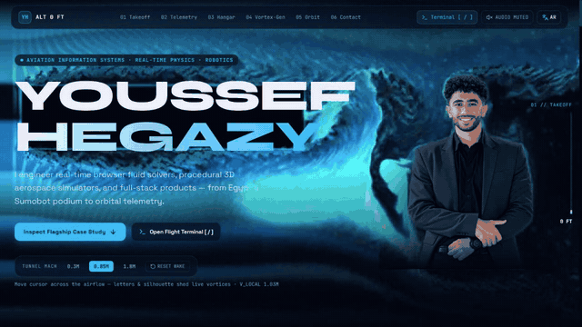
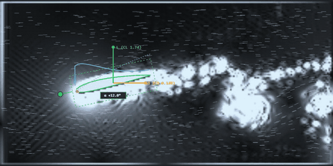
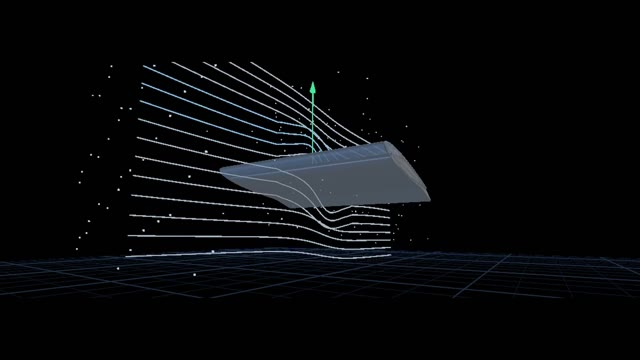
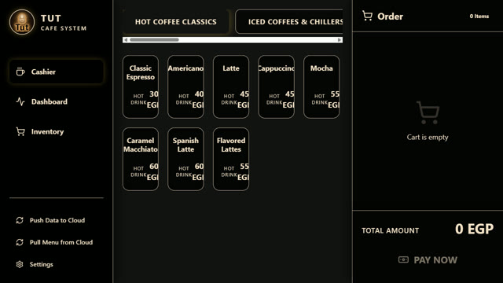
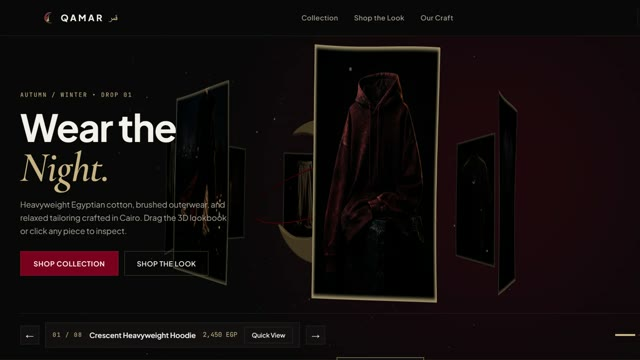
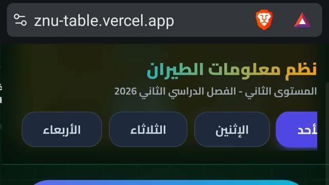

<!-- ═══════════════════════════  HERO  ═══════════════════════════ -->
<a href="https://youssev.vercel.app">
  <picture>
    <source media="(prefers-color-scheme: dark)" srcset="assets/banner-dark.svg">
    <source media="(prefers-color-scheme: light)" srcset="assets/banner-light.svg">
    
  </picture>
</a>

<p align="center">
  <a href="https://youssev.vercel.app"></a>
  <a href="https://youssev.vercel.app/Youssef_Hegazy_CV_Resume.pdf"></a>
  <a href="https://www.linkedin.com/in/youssef-hegazy-0b0900374"></a>
  <a href="mailto:youssefossoss21@gmail.com"></a>
</p>

<p align="center">
  CS student (Aviation Information Systems) at Zagazig National University · Vice Chairman of ZNU Robotics Community<br>
  I build <b>real-time fluid simulations in the browser</b>, <b>procedural 3D aerospace tools</b>, and <b>full-stack products people actually use</b>.
</p>

<!-- ═══════════════════════════  SHOWCASE  ═══════════════════════════ -->

## ✈️ Wind Tunnel

<table>
  <tr>
    <td width="58%" valign="top">
      <a href="https://youssev.vercel.app"></a>
      <sub><b>Portfolio hero</b>: a GPU Navier-Stokes solver where my name and portrait are physical obstacles. Move your cursor, it sheds vortices at 60 FPS. <a href="https://youssev.vercel.app">Try it live →</a></sub>
    </td>
    <td width="42%" valign="top">
      <a href="https://youssev.vercel.app/#vortex-gen"></a>
      <sub><b>Vortex-Gen</b>: Schlieren view of a 220×110 MAC-grid wind tunnel running in real time. <i>Private R&amp;D, demo footage only.</i></sub>
    </td>
  </tr>
</table>

<!-- ═══════════════════════════  PROJECTS  ═══════════════════════════ -->

## 🛫 Flight Log

<table>
  <tr>
    <td width="50%" valign="top">
      <a href="https://youssev.vercel.app/#vortex-gen"></a>
      <h3>Vortex-Gen</h3>
      Real-time aerospace CFD &amp; flight-physics platform. 60 FPS Eulerian Navier-Stokes tunnel, PyTorch airfoil surrogate behind a Dockerized Node gateway, Prandtl lifting-line + ISA atmosphere, procedural F-16C and turbofan 3D dissectors.<br><br>
      <code>Three.js</code> <code>R3F</code> <code>PyTorch</code> <code>Node</code> <code>Docker</code><br>
      <a href="https://youssev.vercel.app/#vortex-gen"><b>Case study →</b></a>
    </td>
    <td width="50%" valign="top">
      <a href="https://tutsystems-kappa.vercel.app"></a>
      <h3>TUT Cafe Systems</h3>
      The point-of-sale system running the specialty café I co-founded: cashier flow, dashboard, inventory, cloud sync. It also has a bilingual menu designer that exports print-ready PDFs.<br><br>
      <code>JavaScript</code> <code>Inventory</code> <code>Cloud sync</code><br>
      <a href="https://tutsystems-kappa.vercel.app"><b>POS →</b></a> · <a href="https://tutcafe.vercel.app"><b>Menu designer →</b></a>
    </td>
  </tr>
  <tr>
    <td width="50%" valign="top">
      <a href="https://qamar-store-main.vercel.app"></a>
      <h3>QAMAR</h3>
      Bilingual luxury streetwear store: draggable 3D lookbook carousel, fabric-sheen viewer, a 3D Visa card at checkout, and dark/light editorial themes.<br><br>
      <code>JavaScript</code> <code>3D UI</code> <code>EN/AR</code><br>
      <a href="https://qamar-store-main.vercel.app"><b>Live store →</b></a> · <a href="https://github.com/yOuSSefOSS/qamar-store-main"><b>Code</b></a>
    </td>
    <td width="50%" valign="top">
      <a href="https://znu-table.vercel.app"></a>
      <h3>znutable v4</h3>
      Offline-first PWA built for my Aviation IS cohort: live lecture countdowns, section filters, exam tracking, and shared study folders on Firestore.<br><br>
      <code>PWA</code> <code>Firebase</code> <code>RTL</code><br>
      <a href="https://znu-table.vercel.app"><b>Live app →</b></a> · <a href="https://github.com/yOuSSefOSS/ZNU-Table-V4"><b>Code</b></a>
    </td>
  </tr>
</table>

<!-- ═══════════════════════════  HONORS  ═══════════════════════════ -->

## 🏆 Honors

- 🥇 **1st Place in Egypt, 500g Sumobot**: national autonomous robotics tournament (TITANS / ZNU Robotics)
- 🏅 **3× hackathon podiums**: 2× 3rd place (incl. Creativa Zag Hub, AI Track) · 1× 2nd place
- 🛰️ **Egyptian Space Agency (EgSA)**: Remote Sensing Specialist certification
- 🤖 **National Telecommunication Institute (NTI)**: Machine Learning specialization

<!-- ═══════════════════════════  STACK  ═══════════════════════════ -->

## 🧰 Stack

<p align="left">
  
</p>

<sub>Also: GLSL / WebGL2 · GSAP · PyTorch inference · Navier-Stokes CFD · Prandtl lifting-line &amp; ISA modelling · IoT telemetry</sub>

<!-- ═══════════════════════════  ACTIVITY  ═══════════════════════════ -->

## 📡 Radar

<picture>
  <source media="(prefers-color-scheme: dark)" srcset="https://raw.githubusercontent.com/yOuSSefOSS/yOuSSefOSS/output/snake-dark.svg">
  <source media="(prefers-color-scheme: light)" srcset="https://raw.githubusercontent.com/yOuSSefOSS/yOuSSefOSS/output/snake-light.svg">
  
</picture>

<!-- ═══════════════════════════  EASTER EGG  ═══════════════════════════ -->

<details>
<summary><b>▸ Open Mission Control</b></summary>

```text
┌──────────────────────────────────────────────────────────────┐
│  MISSION CONTROL // yOuSSefOSS                    [ ONLINE ] │
├──────────────────────────────────────────────────────────────┤
│  PILOT      Youssef Hegazy                                   │
│  BASE       10th of Ramadan City, Egypt                      │
│  ROLE       Robotics Software Lead · Real-time CFD & WebGL   │
│  MISSION    Vortex-Gen: browser-native aerospace CFD         │
│  CRUISE     FL350 · M0.85                                    │
│  STACK      Next.js · WebGL2 · Three.js · Python · Node      │
├──────────────────────────────────────────────────────────────┤
│  TIP        On the portfolio, press  /  for the terminal,    │
│             type  vortex  for overdrive, or try the Konami   │
│             code for afterburner.                            │
└──────────────────────────────────────────────────────────────┘
```

</details>

<p align="center"><sub>Built by hand in the Nocturnal Mach palette · <a href="https://youssev.vercel.app">youssev.vercel.app</a></sub></p>
